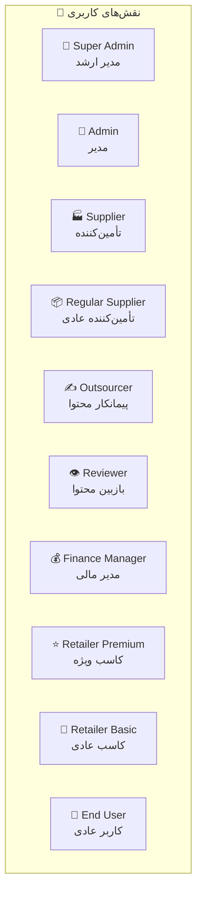
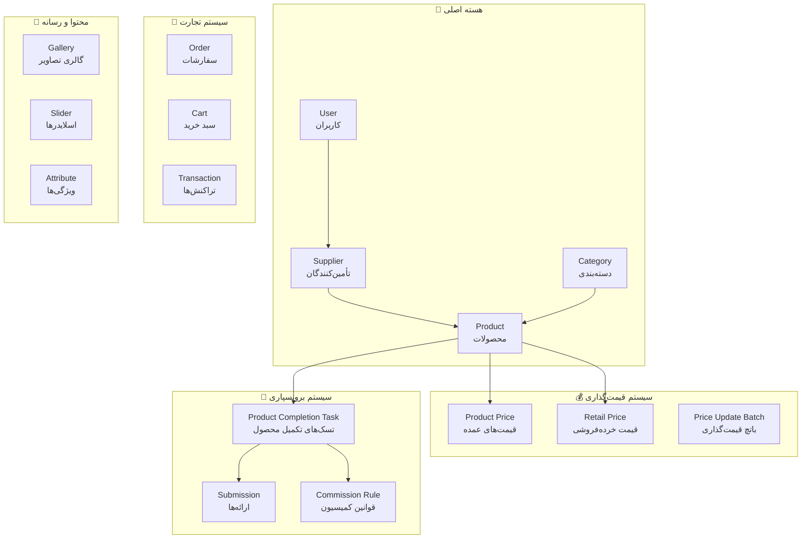
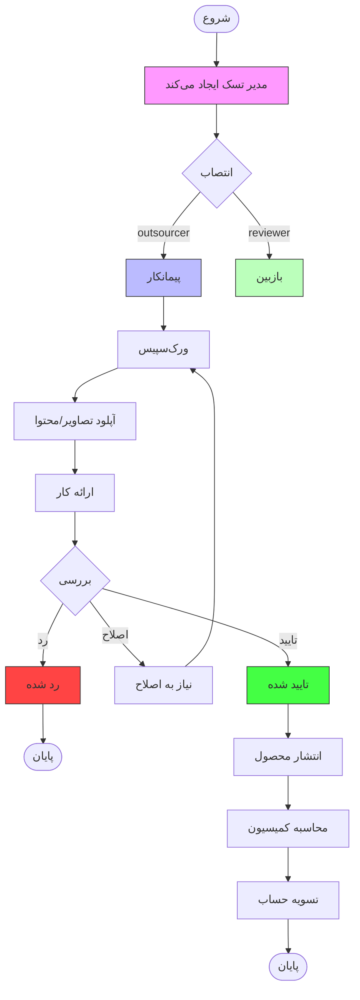
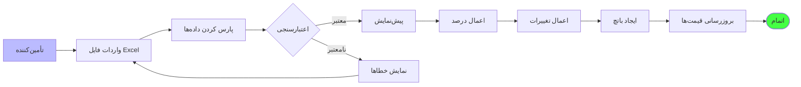
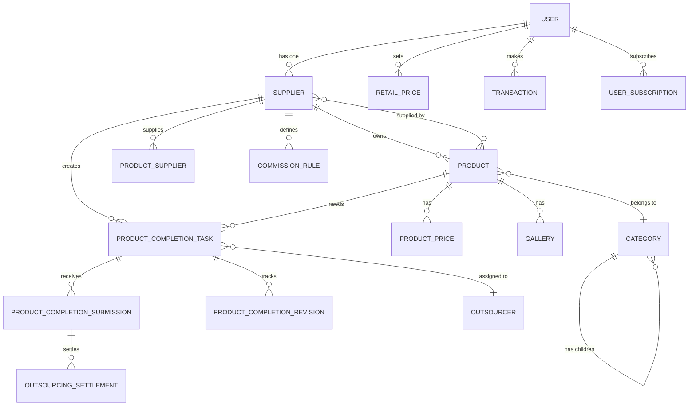
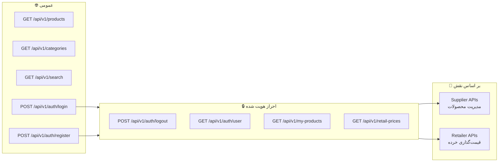
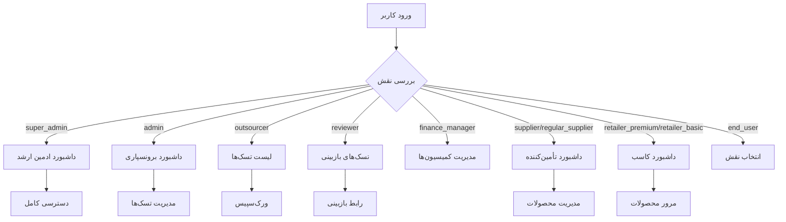
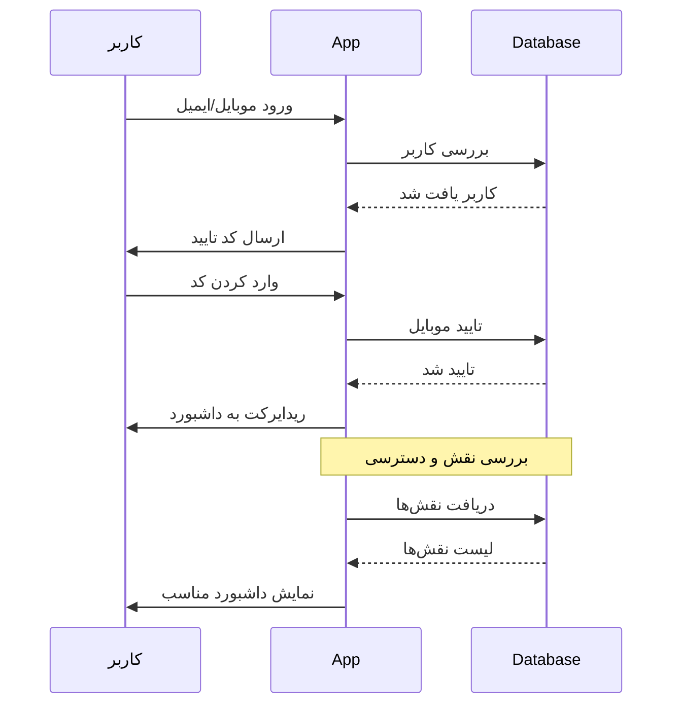
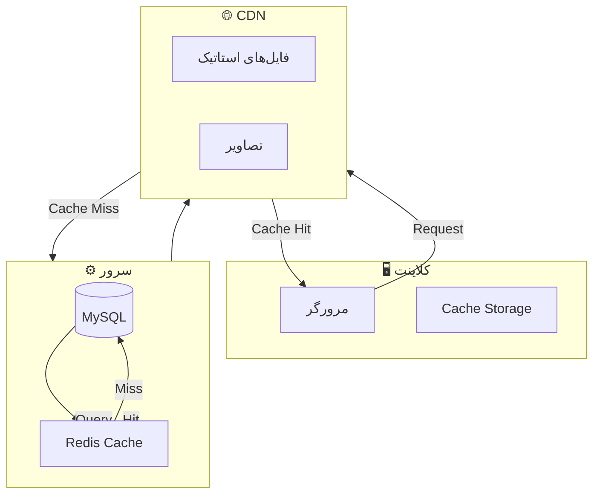

# Workflow Diagram - B2B Marketplace

## ساختار نقش‌های کاربری

## ساختار ماژول‌های اصلی

## گردش‌کار برونسپاری محتوا (Outsourcing Workflow)

## گردش‌کار قیمت‌گذاری سریع (Fast Pricing)

## روابط پایگاه داده (ER Diagram)

## مسیرهای API (API Endpoints)

## داشبورد بر اساس نقش (Role-based Dashboard)

## سیستم احراز هویت (Authentication Flow)

## سیستم کش و Performance

---

**تاریخ ایجاد:** 1407/08/01  
**آخرین بروزرسانی:** 1407/08/01
