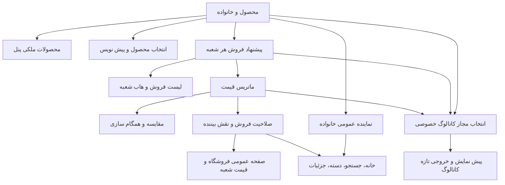

# نقشهٔ نمایش محصول، پیشنهاد و قیمت

## اصل تفکیک نمایش

«محصول اضافه شد» باید با ذکر مقصد بیان شود: ساخته‌شدن Product، اضافه‌شدن پیشنهاد به لیست فروش، قبول انتقال، فعال‌شدن قیمت و انتشار عمومی پنج رویداد متفاوت‌اند. حضور محصول در یک صفحه تضمین حضور در همهٔ صفحه‌ها نیست. این فصل محل‌های مصرف مستقیم را برای تستر مشخص می‌کند؛ نتیجهٔ عمومی باید با نقش، بافت، وضعیت و زمان ثابت آزمایش شود.

## نقشهٔ مصرف داده

## پنل‌های خصوصی

| مصرف‌کننده | معیار اصلی حضور | اثر افزودن/حذف |
|---|---|---|
| محصولات ملکی `/supplier/products` | مالک Product برابر بافت جاری | نسخهٔ قدیمی ملکی می‌تواند ظاهر شود؛ افزودن جدید Product مشترک را ملکی نمی‌کند |
| لیست فروش `/supplier/my-products` | پیشنهاد همان شعبه | افزودن پیشنهاد ظاهر؛ حذف پیشنهاد ناپدید؛ Product مستقل باقی |
| انتخاب محصول `/supplier/product-selection` | خانوادهٔ canonical و status فعال | حذف فروش شعبه محصول عمومی قابل انتخاب را لزوماً حذف نمی‌کند |
| پیش‌نویس‌های صفحهٔ انتخاب | draft ملکی اصلی/شعبه‌های مالک | ادامهٔ فرم با تغییر بافت به مالک پیش‌نویس |
| صف انتقال | انتقال pending شعبهٔ محلی | قبول/رد از pending خارج؛ حذف هاب ممکن است برگرداند |
| محصولات هاب | پیشنهاد زنده با Product زنده در شعبهٔ محلی | قبول انتقال غیرفعال نیز قابل مدیریت است |
| ویرایش قیمت | محصول و پیشنهاد مجاز در بافت | حضور در لیست، مجوز ویرایش محتوایی ایجاد نمی‌کند |

## سایت عمومی و خانوادهٔ canonical

دامنهٔ `Product::active` نیازمند `status=active` و `is_active=true` است. canonical از اعضای فعال/حذف‌نشدهٔ خانواده نماینده انتخاب می‌کند و مرجع اولیه را ترجیح می‌دهد. در صفحه‌های متکی بر canonical نباید برای هر شعبه یک کارت تکراریِ بی‌دلیل ایجاد شود.

| مسیر/بخش | نقش داده و شروط مهم | آزمون لازم |
|---|---|---|
| `/` خانه | queryهای canonical، اولویت قیمت‌دار و کش صفحه | یک خانواده، ترتیب و تازه‌شدن پس از تغییر قیمت |
| `/products` | فهرست عمومی محصولات طبق فیلترهای کنترلر | تأیید/فعال‌بودن و عدم تکرار خانواده |
| `/search` | عنوان/فیلترهای جستجو با محصولات فعال و canonical | draft و inactive در نتایج عمومی فعال وارد نشوند |
| `/categories/{slug}` | محصولات فعال دسته و عرضه‌های مرتبط خانواده | تغییر دسته/وضعیت و حذف فروش یک شعبه درست منعکس شود |
| `/products/{slug}` | جزئیات محتوا و قیمت‌های خانواده؛ URL نسخه تابع هدایت canonical | مقصد نهایی، محتوای مرجع و قیمت شعبه‌ها جدا کنترل شوند |
| محصولات مرتبط/اخیراً دیده‌شده | انتخاب نماینده‌های فعال خانواده | عضو غیرفعال یا نسخهٔ تکراری نشت نکند |
| `/suppliers/{slug}` | صفحهٔ فروشگاه با ریشه و شعبه‌های فعال | فهرست و قیمت از دامنهٔ همان خانوادهٔ فروشگاه باشد |
| `/suppliers/profile/{supplier}` | ورودی قدیمی صفحهٔ فروشگاه | رفتار سازگاری/هدایت با URL جدید بررسی شود |
| `/products/{id}/prices/snapshot` | endpoint قیمت احرازهویت‌شده و محدودشدهٔ درخواست | احراز، نرخ درخواست، نقش، صلاحیت قیمت و شعبه |
| `/sitemap-products.xml` | محصولات `active`؛ query فعلی الزام canonical ندارد | احتمال URL نسخه و هدایت آن در GAP-09 لحاظ شود |

صفحهٔ عمومی فروشگاه می‌تواند محصول canonical ملکی اصلی را حتی بدون پیشنهاد همان اصلی نشان دهد؛ وجود خانواده و عرضهٔ شعبه‌ها نیز در انتخاب نقش دارد. بنابراین پس از حذف یک پیشنهاد، انتظار «کارت محصول حتماً حذف شود» صحیح نیست. انتظار قطعی این است که قیمت و عرضهٔ حذف‌شده به نام آن شعبه باقی نماند.

ساختار اصلی ثابت است؛ درخواست قدیمی اصلی‌کردن شعبه با ۴۰۳ رد می‌شود. پس از این درخواست، URL فروشگاه، URL محصول، مالک/خانوادهٔ Product، هویت فروشنده و قیمت/لینک منبع ثابت‌اند. انتخاب شعبهٔ فعال فقط بافت پنل را تغییر می‌دهد و اسلاگ فروشگاه یا مبنای اصلی را جابه‌جا نمی‌کند. قرارداد عدم اثر در [ساختار ثابت اصلی](15-primary-branch.md) آمده است.

## صلاحیت قیمت و نقش بیننده

باید این لایه‌ها جدا کنترل شوند: محصول فعال/تأییدشده، پیشنهاد حذف‌نشده و فعال، وضعیت مجاز پیشنهاد در مسیر مربوط، تأمین‌کنندهٔ فعال/تأییدشده، قیمت فعال و در بازهٔ اعتبار، نوع قیمت مجاز برای نقش بیننده و اجازهٔ دیدن اطلاعات تأمین‌کننده. همهٔ queryها دقیقاً یک مجموعه شرط ندارند؛ آزمون endpoint و صفحه جدا لازم است.

`PriceVisibilityService` تنظیمات نقش‌ها را می‌خواند. نقش‌های مهم برای ماتریس تست: مهمان، کاربر عادی، سطوح عضویت، تأمین‌کننده و مدیر. اجازهٔ قیمت خرده، عمده، فیلتر قیمت و اطلاعات فروشنده مستقل است؛ ورود به حساب به‌تنهایی مجوز همهٔ قیمت‌ها نیست. در نبود بعضی تنظیمات، پیش‌فرض خرده با عمده/اطلاعات فروشنده یکسان نیست. تست باید تنظیمات را صریح بسازد.

snapshot قیمت نیازمند auth و محدودیت ۶۰ درخواست در دقیقه است. این endpoint فقط از UI محافظت نمی‌شود؛ درخواست مستقیم بدون مجوز نباید قیمت یا اطلاعات شعبهٔ محدود را لو بدهد. دستهٔ قیمت چکی باید دوره و تیراژ درست داشته باشد. قیمت منقضی با برچسب «قیمت‌دار» پنل نباید از این مسیر منتشر شود.

## کاتالوگ و PDF خصوصی

کاتالوگ خصوصی قرارداد جدا از انتشار عمومی دارد. `forSupplierCatalog` محصول active یا draft ملکی در شناسه‌های مالک مجاز را می‌پذیرد. در Preview، محصول به پیشنهاد فعال متعلق به دامنهٔ انتخاب‌شده و دارای قیمت فعال نیز نیاز دارد؛ صرف ساخت draft باعث حضور در PDF نمی‌شود.

مالک قالب باید با `currentSupplier` کاربر غیرمدیر تطبیق کند. دامنهٔ شعبه یکی از `single`، `selected` و `all` است. خانوادهٔ قابل انتخاب از اصلی فعال همان مالک و شعبه‌های فعال و تأییدشدهٔ او تشکیل می‌شود. انتخاب شناسهٔ بیرونی یا لیست selected تهی باید رد شود. قالب مدیر مسیر انتخاب جدا دارد و با آرایهٔ مالک draft خالی، مجوز عمومی نمایش پیش‌نویس دیگران نمی‌گیرد.

فیلتر دسته، نوع قیمت، دوره، تنظیمات نمایش و ارز/نرخ می‌توانند آیتم نهایی را محدود کنند. query کاتالوگ قیمت فعال را می‌خواند؛ همسانی تمام قواعد تاریخ اعتبار آن با endpoint عمومی را بدون تست فرض نکنید. انتخاب مجاز draft در خروجی خصوصی، آن محصول را در سایت تأیید یا عمومی نمی‌کند.

اطلاعات تصویر، خانواده، دسته و ویژگی‌ها برای خروجی بارگیری می‌شود. تنظیمات شعبه و ارز باید در snapshot/کلید کش منعکس شوند. نسخهٔ دادهٔ کش Preview به ۴ و schema snapshot به ۶ تغییر کرده تا خروجی قدیمی با قرارداد جدید اشتباه بازیابی نشود. PDF دانلودشده فایل ثابت است؛ فقط پیش‌نمایش/تولید بعدی از دادهٔ تازه استفاده می‌کند.

## اثر عملیات بر محل نمایش

| عملیات | پنل و لیست فروش | سایت عمومی | کاتالوگ بعدی |
|---|---|---|---|
| ساخت draft | محصولات ملکی و پیش‌نویس‌ها | منتشر نمی‌شود | فقط با مالک/پیشنهاد/قیمت و تنظیمات مجاز |
| قبول انتقال | همان Product با پیشنهاد غیرفعال مقصد؛ صف از pending خارج | پیشنهاد غیرفعال منتشر نمی‌شود | تا فعال‌شدن پیشنهاد شرط حضور را ندارد |
| افزودن پیشنهاد فعال | لیست فروش شعبه | با سایر لایه‌های صلاحیت | با قیمت فعال و دامنهٔ مجاز |
| ذخیرهٔ قیمت | ماتریس و مقایسه تازه | فقط قیمت مجاز/فعال/معتبر برای نقش | طبق تنظیمات و snapshot تازه |
| بایگانی پیشنهاد | رکورد برای مدیریت باقی؛ قیمت‌ها غیرفعال | عرضهٔ بایگانی‌شده نباید فعال بماند | پیشنهاد غیرفعال از انتخاب فعال خارج |
| حذف پیشنهاد | از لیست فروش حذف؛ Product ملکی ممکن است باقی | قیمت این پیشنهاد حذف؛ کارت خانواده ممکن است باقی | این پیشنهاد دیگر منبع نیست |
| حذف شعبه | شعبه و پیشنهاد/قیمت حذف؛ Product بدون مالک می‌ماند | شعبه/قیمتش حذف؛ خانواده ممکن است بماند | شعبه از دامنهٔ مجاز خارج |
| درخواست ممنوع اصلی‌کردن | ۴۰۳؛ ساختار، بافت و داده ثابت | URL، هویت و قیمت مجاز ثابت | دامنه، revision و فایل قبلی ثابت |

## کش، صف و روش مشاهدهٔ نتیجه

سرویس‌های دامنه revision قیمت و باطل‌سازی کش عمومی را اعمال می‌کنند؛ برخی رویدادها و broadcast پس از commit از صف استفاده می‌کنند. تست باید یک بار cache گرم، سپس تغییر، سپس بازخوانی واقعی مصرف‌کننده را اجرا کند. فقط پاک‌کردن دستی همهٔ کش‌ها نمی‌تواند صحت invalidation را ثابت کند.

برای خطا، snapshot قدیمی نباید با دادهٔ ناقص تازه مخلوط شود. صف متوقف و صف فعال دو سناریوی متفاوت‌اند. کنترلر عمومی، snapshot، خروجی HTML کاتالوگ و فایل PDF تولیدشده هرکدام نقطهٔ مشاهدهٔ جدا هستند. sitemap کش زمانی جدا دارد؛ تأخیر آن را با شکست cache قیمت یکی ندانید.

## سناریوهای پذیرش

| شناسه | اقدام | انتظار |
|---|---|---|
| VIS-01 | draft دارای قیمت فعال ساخته شود | در عمومی منتشر نشود؛ کاتالوگ خصوصی فقط با دامنهٔ مجاز |
| VIS-02 | خانواده سه نسخهٔ فعال داشته باشد | در query canonical نمایندهٔ واحد؛ قیمت شعبه‌ها با شناسهٔ درست |
| VIS-03 | فقط پیشنهاد B حذف شود | قیمت B حذف؛ قیمت C و محتوای خانواده باقی |
| VIS-04 | پیشنهاد/تأمین‌کننده/قیمت هرکدام جدا غیرفعال شوند | هر مصرف‌کننده طبق قرارداد خودش فیلتر کند؛ endpoint نشت ندهد |
| VIS-05 | نقش مهمان و عضو با تنظیمات متفاوت صفحه/endpoint را بخوانند | انواع قیمت و اطلاعات فروشنده مطابق تنظیمات، نه صرف login |
| VIS-06 | قیمت آینده/منقضی/فعال معتبر ایجاد شود | عمومی فقط ردیف مجاز زمانی؛ پنل می‌تواند هر سه را برای مدیریت ببیند |
| VIS-07 | قالب B با جلسه C یا selected شامل مالک دیگر باز شود | رد؛ draft/قیمت خصوصی نشت نکند |
| VIS-08 | scope کاتالوگ single/selected/all عوض شود | دامنهٔ مجاز دقیق و بدون شعبهٔ غیرفعال/تأییدنشده |
| VIS-09 | cache گرم سپس قیمت sync شود | بازخوانی عمومی/کاتالوگ دادهٔ تازه مطابق revision |
| VIS-10 | PDF قبلی نگه داشته و قیمت تغییر کند | فایل قبلی ثابت؛ تولید جدید از دادهٔ تازه |
| VIS-11 | مستقیم snapshot بدون auth یا بیش از حد مجاز خوانده شود | احراز/محدودیت اعمال؛ بدون افشای payload ممنوع |
| VIS-12 | مرجع خانواده غیرواجدشرایط شود | نمایندهٔ جدید مطابق scope؛ لینک‌ها و هدایت بررسی شوند |
| VIS-13 | sitemap برای نسخهٔ شعبه تولید شود | رفتار فعلی active ثبت؛ تفاوت canonical با GAP-09 مرتبط |
| VIS-14 | حذف شعبه با محصول هنوز فروخته‌شده توسط C انجام شود | شعبه B حذف؛ محصول و قیمت C در محل مجاز باقی |

## منابع

`app/Models/Product.php`، `app/Http/Controllers/Web/{HomeController,SearchController,ProductController,ProductPriceSnapshotController}.php`، `app/Livewire/Web/SupplierProducts.php`، `app/Services/PriceVisibilityService.php`، `app/Livewire/Supplier/Catalog/Preview.php`، `app/Services/SupplierBranchPublicCacheInvalidator.php`، `routes/web.php`.

> تکمیل ۲۰۲۶/۱۱/۱۲: نمایش قیمت علاوه بر شروط قبلی به اجازه تیراژ تأمین‌کننده و انتخاب تیراژ همان عرضه وابسته است. تنظیم خاموش تأمین‌کننده حتی با انتخاب روشن محصول اجازه نمایش نمی‌دهد. مسیرهای کارت، جزئیات، snapshot، اعلان قیمت و کاتالوگ تازه و سناریوهای آزمون در [فصل ۱۶](16-supplier-tier-availability.md) فهرست شده‌اند.
